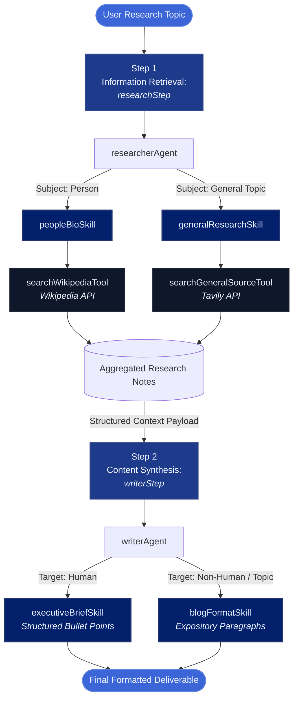

# Autonomous Multi-Agent Research & Synthesis Workflow

[](https://mastra.ai/)
[](https://tavily.com/)
[](https://developer.mozilla.org/en-US/docs/Web/JavaScript)


A deterministic, 2-stage automated research and writing system built on the **Mastra framework**. The architecture uses modular agent skills to dynamically route retrieval operations across Wikipedia and Tavily, passing aggregated research notes downstream to a context-aware writer agent that adapts its output format based on whether the entity is human.

---

> [!NOTE]
> ### TL;DR
> * **What it is:** A Node.js backend research pipeline generating structured profiles and articles from natural language prompts.
> * **How it works:** Dynamically routes queries to Wikipedia (for people) or Tavily (for general topics), then formats the aggregated notes into either executive briefs or long-form paragraphs.
> * **Architecture:** A 2-step sequential workflow coordinating 2 agents, 4 skills, and 2 external tools.
> * **Tech Stack:** Mastra, Node.js, TypeScript, Tavily API, Wikipedia API.

---

## Architecture Overview

The system executes a strictly partitioned, 2-phase pipeline that isolates live information retrieval from output synthesis:



---

## Pipeline Workflow Details

### 1. `researchStep` (Retrieval Phase)
* **Agent**: `researcherAgent`
* **Objective**: Analyzes the input prompt, selects the appropriate retrieval strategy based on entity classification, and collects contextual notes.
* **Skills & Tool Integrations**:
  * `peopleBioSkill`: Invoked when the target subject is an individual. Delegates retrieval to `searchWikipediaTool` to extract biographical milestones, career trajectory, and historical facts from Wikipedia.
  * `generalResearchSkill`: Invoked for concepts, technologies, events, or non-human entities. Delegates to `searchGeneralSourceTool` to perform web searches and extract real-time data via the Tavily API.
* **Handoff**: Synthesizes query results into an intermediate, unformatted `Research Notes` buffer passed downstream.

### 2. `writerStep` (Synthesis & Formatting Phase)
* **Agent**: `writerAgent`
* **Objective**: Converts raw research notes into a finalized document matched to the subject's entity type.
* **Skills & Output Rules**:
  * `executiveBriefSkill`: Activated strictly for human subjects. Formats findings into a concise, scannable executive brief composed of structured bullet points.
  * `blogFormatSkill`: Activated strictly for non-human subjects and general topics. Synthesizes findings into continuous, expository long-form paragraphs suitable for an article or blog post.

---

## Agent Skills & Tools Reference

The system modularizes operational capabilities using Mastra agent skills and tool bindings:

### 1. Retrieval Layer
* `searchWikipediaTool`: Handles direct querying against the Wikipedia API, extracting clean text summaries and biographic details.
* `searchGeneralSourceTool`: Interfaces with Tavily Search API to execute web-scale queries and parse relevant external web context.

### 2. Operational Skills
* `peopleBioSkill`: Encapsulates entity recognition logic for human targets and coordinates Wikipedia search workflows.
* `generalResearchSkill`: Encapsulates web retrieval heuristics and relevance scoring for non-person topics.
* `executiveBriefSkill`: Prompt-engineered skill enforcing structured, bullet-driven executive summaries for profiles.
* `blogFormatSkill`: Content generation skill enforcing cohesive narrative structure and paragraph formatting for informational topics.

---

## Quickstart

```bash
# 1. Clone repository
git clone [https://github.com/your-username/mastra-research-writer-workflow.git](https://github.com/your-username/mastra-research-writer-workflow.git)
cd mastra-research-writer-workflow

# 2. Install dependencies
npm install

# 3. Add your environment credentials in .env (TAVILY_API_KEY + LLM API keys)

# 4. Start the Mastra development server
npm run dev